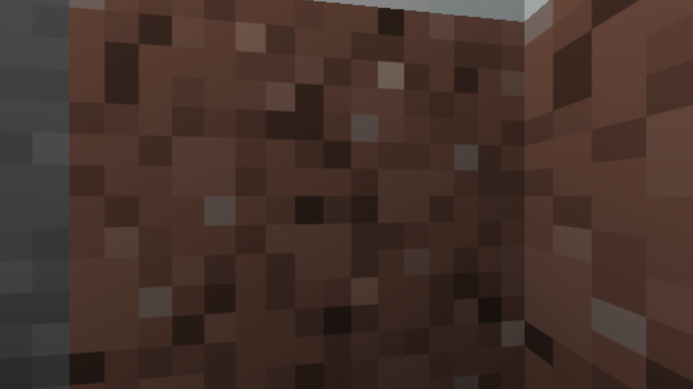

# Gorilla Passthrough

Be your Gorilla Tag gorilla in a real Minecraft world, with **both games running at the same time**. It's a
passthrough mod like Spider-Man × Arkham Knight: neither game's files are copied into the other. Each game does the
part it is good at, and the two talk over a local bridge.

| | Gorilla Tag does | Minecraft does |
|---|---|---|
| Body | VR, your gorilla, arm locomotion, physics | follows the gorilla (its player stands where the gorilla's feet are) |
| World | collides with Minecraft's blocks (invisible colliders) | the world itself: blocks, mobs, day/night, crafting, saving |
| Picture | shows Minecraft's picture in VR, with the gorilla in front of it | draws the world **from the gorilla's head**, every frame |



## How the bridge works

```
 Gorilla Tag (BepInEx plugin)                        Minecraft 26.3 (Fabric mod)
 ─────────────────────────────                       ───────────────────────────
 head pose + field of view, feet  ──TCP 25600──►   camera = gorilla head, player = gorilla feet
 hand actions (mine/place/punch)  ──TCP 25600──►   MultiPlayerGameMode (real Minecraft actions)
 invisible box colliders          ◄──TCP 25600──   solid blocks near the gorilla, per 16³ section
 teleports, mobs, health          ◄──TCP 25600──   respawn / portals / ender pearls, entity boxes
 depth mesh + texture             ◄─shared memory─  colour image + depth grid of every frame
 wrist screen                     ◄─shared memory─  the whole window (HUD, chests, crafting)
```

- **The picture.** After Minecraft draws the world (before its HUD and hand), it copies the colour and depth
  buffers off the GPU without waiting, then writes them into Windows shared memory (`Local\GorillaPassthroughFrames`).
  Gorilla Tag turns the depth into a 3D mesh, textures it with the colour image, and places it at the exact head pose
  that frame was drawn from. Because the picture is real geometry, both eyes get depth, the world stays still when you
  turn your head (even though the frame is a little late), and your gorilla arms go in front of or behind blocks
  correctly. It only uses shaders already in Gorilla Tag's build, so no Unity editor is needed.
- **The body.** Gorilla Tag's own physics moves the gorilla over invisible colliders built from Minecraft's blocks.
  Minecraft's player is gorilla-sized (0.5 × 0.8 blocks) and its single-player server trusts the gorilla's position.
- **Offline only.** Gorilla Tag is kept out of online rooms while the mod is on, because modded players get banned in
  public lobbies.

## Play

**Download** `gorillapass-0.1.0.jar` and `GorillaPassthrough.dll` from the
[latest release](https://github.com/arvabarva/Gorillatag-Minecraft-Passtrough/releases/latest). You need Minecraft Java
Edition 26.3, Gorilla Tag on Steam, a VR headset and a PC that can run both at once.

1. **Minecraft:** in the Modrinth App (or any launcher with Fabric), make a new **Fabric 26.3** profile. Add
   **Fabric API** (and **Essential** to play with friends), then put `gorillapass-0.1.0.jar` into that profile's `mods`
   folder. Leave Iris and Vivecraft out (Sodium is untested). Start it and open a world. Keep the Minecraft window
   open (not minimised).
2. **Gorilla Tag:** install [BepInEx 5](https://github.com/BepInEx/BepInEx/releases) (`BepInEx_win_x64_5.4.x`) into
   the Gorilla Tag folder (Steam → Gorilla Tag → Manage → Browse local files), start Gorilla Tag once and close it.
   Then put `GorillaPassthrough.dll` into `BepInEx/plugins/GorillaPassthrough/`. Start Gorilla Tag from Steam with the
   headset on. It connects by itself and puts the gorilla where your Minecraft player is.

Minecraft pauses itself when its window loses focus (when you put the headset on). While Gorilla Tag is linked, the
mod closes that pause menu so mobs and block breaking keep running. If you click into the Minecraft window on the
monitor, you can still pause there.

The games can start in either order. Closing either one is safe: Minecraft goes back to normal play, and Gorilla Tag
waits for Minecraft to come back.

**Controls** (moving is normal Gorilla Tag):
- hand on a block + hold **trigger**: mine it (only the trigger mines; walking never does). The block gets an
  outline while you squeeze trigger or grip near it
- hand on a block + **grip**: place the held block, open doors / chests / crafting tables
- **grip** in the air: hold it to eat or drink (like holding right click), draw a bow, raise a shield
- hand in a mob or player + **trigger**: hit it (you feel Minecraft's hits in your controllers)
- **Y**: inventory. Minecraft's real menu floats in front of you; point with your right hand: **trigger** = click,
  **grip** = right click, hold the **left grip** for shift-click. Chests, crafting tables and furnaces open the same way
  (grip on them). Y again closes the menu
- the item in your hotbar is in the gorilla's right hand, drawn by Minecraft itself; tools mine at their real speed
  (a pickaxe for stone, an axe for wood), also while you hang off a wall
- left thumbstick left/right: hotbar slot, **B**: drop item, **X**: wrist screen on/off
- raise your left hand: the wrist screen shows Minecraft's window (hotbar, hearts)

No fall damage, and you respawn by yourself after dying.

**Normal Gorilla Tag:** Gorilla Tag stays offline while the plugin is on (modded players get banned in public lobbies).
To play online again, set `Enabled = false` in `Gorilla Tag/BepInEx/config/com.gorillapass.gorillatag.cfg`, or remove
the plugin. Don't run other mods that also take over Gorilla Tag at the same time.

## Play with a friend

Multiplayer goes through Minecraft (Gorilla Tag stays offline for both of you). The host opens their Minecraft world to
others (Essential's invite, or Open to LAN); the friend joins it. Each player's Minecraft tells the server it's a
gorilla, with its Gorilla Tag fur colour, and where its hands are; everyone is drawn as a gorilla in their own colour,
with their armour and held item, arms reaching for their real hands (`GorillaNet`, `AvatarRendererMixin`,
`PlayerModelMixin`). The server (the host's Minecraft, or a server with this mod) trusts gorillas' movement.

Players who play through Gorilla Tag see each other as real Gorilla Tag gorillas (`OtherGorillas`): each plugin sends
its gorilla's bone pose (where Gorilla Tag's own arm IK put the bones) through Minecraft (`C_RIG` -> `GorillaNet.Rig`
-> `S_REMOTE_RIG`), and the others' plugin poses a copy of the gorilla model (copied while switched off and stripped
to its meshes, coloured through a property block like Gorilla Tag does) exactly like that, with their held item and
armour. Minecraft then doesn't draw its own model of them (`EntityRenderDispatcherMixin`).

Both players need the same version of both files (the
[latest release](https://github.com/arvabarva/Gorillatag-Minecraft-Passtrough/releases/latest)).

Testing on one PC: `gradlew runPassthroughTest` (opens the test world to LAN without account checks) and
`gradlew runPassthroughTestB` (a second player that joins it, on link port 25601), then `python tools/mp_gorilla.py b`
and `python tools/mp_gorilla.py a`: each saves what its Minecraft drew to `tools/out/mp-a.png` / `mp-b.png`.

## Build and test

You need JDK 25 for the Minecraft mod, and for the Gorilla Tag plugin Gorilla Tag with BepInEx 5 installed plus the C#
compiler from Visual Studio (Community is free). `gt/build.ps1` compiles against Gorilla Tag's own assemblies, which
are not in this repository; set the paths to your Gorilla Tag folder and `csc.exe` at its top if yours differ.

```bash
cd mc && gradlew build
```

The mod ends up in `mc/build/libs/`.

```bash
powershell -File gt/build.ps1
```

(Close Gorilla Tag first; this also installs the plugin.)

Test the Minecraft side without Gorilla Tag: `cd mc && gradlew runPassthroughTest` opens the test world `gptest`,
then `python tools/fake_gorilla.py` connects as a fake gorilla, turns its head, mines a block and saves the frame it got
to `tools/out/`. Setting `Screenshots = true` in the plugin's config saves desktop and head-view screenshots to
`BepInEx/`.

## Notes

- Minecraft 26.3's OpenGL backend forgets to reset its read buffer after copying a depth texture (vanilla never does
  this). `GlCommandEncoderMixin` puts it back.
- The world's depth has to be copied before `GameRenderer.render3dHud`, which clears it before drawing the hand.
- Cells of the depth mesh that span a depth edge are drawn twice, each corner moved along its own line of sight: once
  on the near thing (joined to the near neighbours) and once on the far surface (joined to the far neighbours). From
  the head the picture is unchanged; seen from a little to the side, leaves keep their depth and no gaps open up.
  Behind big near things (a sword in front of your face) a backdrop in Minecraft's current sky colours shows instead
  of Gorilla Tag's own sky.
- Points moved off the grid are moved once for all the cells around them, so the far and near copies join up. (Moved
  per cell, cracks opened between neighbouring cells as soon as an eye was beside where Minecraft drew from, and the
  sky flickered through them along every edge: the "screen tearing".)
- What your eyes see behind near things comes from a quarter-size background picture, where near things are filled in
  from what is behind them (push-pull, farther pixels counting more), drawn under the picture's own far pixels.
- Minecraft copies its frame off the GPU on the render thread, but builds the mesh and fills shared memory on its own
  thread ("Gorilla Passthrough frames"); that took about 7 ms of every frame before.
- `tools/dump_frame.py` saves what Minecraft last shared (picture, near/far mask, background picture). With
  `Screenshots = true` the plugin also saves `gorillapass-eye-N.png` (3 cm to the side) and `gorillapass-moved-N.png`
  (15 cm to the side), where edge problems show.
- The held item is not in Minecraft's picture (anything that close to the eyes leaves a hole behind it and lags the
  hand). Minecraft sends its picture instead (`HeldItemSender`: the loaded sprite, first frame, tinted) and Gorilla
  Tag builds it as a 3D pixel model in the fist (`HeldItemModel`), lit by Minecraft's light level there. Swords and
  tools sit by the handle; `HeldItemTiltDegrees` in the plugin config sets how far they point up
  (`docs/held-item.png`).
- Armour works the Minecraft way: put it on in the inventory and it protects you. Gorilla Tag dresses the gorilla in
  Minecraft's own armour textures (`textures/entity/equipment/humanoid*/...`, leather in its dye colour), laid out like
  Minecraft's model cubes: the helmet round the head, the chestplate round the upper body, the leggings' waist round the
  hips, the boots' feet over the knuckles. Anything else worn on the head (a pumpkin) is a box in its colours.
- Minecraft logs every 10 seconds while linked how many frames it copied, shared and skipped; a warning when none were
  shared.
- Minecraft 26.3 reads the mouse through SDL3 (buttons 1 = left, 3 = right); `MenuPointer` feeds the hand's pointer
  to `MouseHandler.onMove/onButton`, so every menu works as with a real mouse.
- Tested on desktop without a headset (Gorilla Tag's non-VR mode): the link, the frames, the colliders and standing
  on Minecraft ground all worked. VR still needs a session in the headset to tune comfort.
